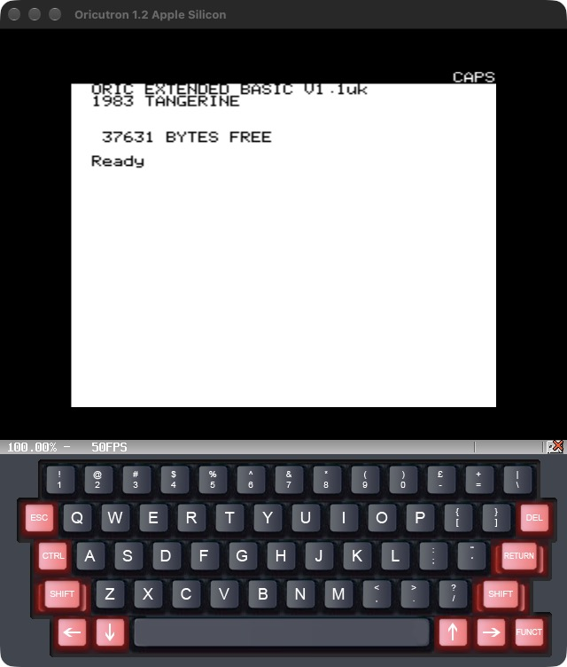

ORICUTRON pour Mac Apple Silicon, iPhone et iPad
================================================
Compilé avec ClaudeAI
=====================

Émulateur Oric-1 / Oric Atmos / Telestrat / Pravetz 8D.
Cœur d'émulation : Oricutron (Peter Gordon https://github.com/pete-gordon/oricutron , licence GPL v2).
Couches macOS et iOS réécrites en Swift.

- **Mac** : macOS 11 (Big Sur) ou plus récent, Mac Apple Silicon (M1, M2, M3, M4…).
  L'application compilée de `releases/` ne fonctionne pas sur les Mac Intel.
- **iPhone / iPad** : iOS / iPadOS 15 ou plus récent (voir « Sur iPhone / iPad » plus bas).

Page de présentation : https://gliou.github.io/Oricutron-1.2-macOS-Silicon/

Ce dépôt ne contient que les émulateurs (Mac et iPhone / iPad). Les programmes
pour l'Oric Atmos testés avec eux (jeu du serpent en BASIC et en C, démo HIRES,
écran titre 6502, musiques, outils .tap / .dsk) sont dans un dépôt séparé :
https://github.com/Gliou/Programmes-Oric
<!-- Modifié le 2026-11-27 by GliouCNR©70 : programmes Oric déplacés dans leur propre dépôt -->

IN ENGLISH
----------
**Oricutron 1.2 for Apple Silicon Macs, iPhone and iPad** — a native port of
Peter Gordon's Oricutron, the Oric-1 / Oric Atmos / Telestrat / Pravetz 8D emulator.

- Native macOS app (Swift + SDL2) for M1, M2, M3, M4… Macs: native menus, drag and
  drop of `.tap` / `.dsk` / `.sna` files, positional keyboard mapping for non-QWERTY
  keyboards, on-screen Oric keyboard.
- iPhone / iPad app (iOS 15+) with a touch Oric keyboard and import of ROMs and
  tapes/disks from the Files app.
- Downloads: `releases/Oricutron-macOS-arm64.zip` (Mac) and
  `releases/Oricutron-iOS-unsigned.ipa` (iPhone / iPad, to be signed with your own
  Apple ID, e.g. with Sideloadly or AltStore, or built with Xcode from `ios/`).
- Oric ROMs are copyrighted and **not included** (`basic11b.rom` must be added).
- Licence: GNU GPL v2, like the original Oricutron. All credit for the emulator
  goes to Peter Gordon and the Oricutron contributors.

ORIGINE ET CRÉDITS
------------------
Oricutron est l'œuvre de **Peter Gordon** et de ses contributeurs :
https://github.com/pete-gordon/oricutron

Il est distribué sous licence GNU GPL v2 (voir LICENSE.txt), tout comme ce portage.
Un grand merci à eux pour cet émulateur.

Organisation du dépôt :

- **à la racine** : les sources d'Oricutron, rangées comme dans le dépôt d'origine
  (cœur C, roms/, disks/, tapes/, fichiers de compilation Windows, Linux, Amiga…) ;
- **macos/** : couche native macOS (Swift) et scripts de compilation ;
- **ios/** : version iPhone / iPad (Swift, projet XcodeGen) ;
- **releases/** : applications compilées (sans la ROM basic11b, pour les droits d'auteur).

Fichiers d'Oricutron modifiés pour ce portage (par rapport au dépôt d'origine) :

- **main.c** : branchement des couches Swift (menus natifs, glisser-déposer, clavier
  par position), lecture d'un oricutron.cfg placé à côté de l'app, et correction du
  blocage lors du passage entre rendu OpenGL et rendu logiciel ;
- **keyboard.c / keyboard.h** : un clic bref sur le clavier virtuel est maintenu au
  moins 3 images, pour que la ROM de l'Oric voie la touche ;
- **gui.c** : retour au rendu logiciel si OpenGL est indisponible, lien vers ce dépôt
  dans le menu ;
- **system_sdl.c** : création du contexte OpenGL compatible avec les macOS récents,
  rattachement de la fenêtre SDL à l'app sur iPhone / iPad.

Les autres fichiers du cœur n'ont pas été modifiés.

1. INSTALLATION
---------------
### Sur Mac

Décompresse le fichier .zip, puis glisse « Oricutron » dans le dossier « Applications ».

Premier lancement : l'app n'est pas notariée par Apple, macOS va donc
la bloquer (« Oricutron ne peut pas être ouvert… »). Pour l'autoriser :

  • Clic droit (ou ctrl-clic) sur Oricutron > Ouvrir > Ouvrir
  • ou : Réglages Système > Confidentialité et sécurité >
    en bas, « Oricutron a été bloqué » > Ouvrir quand même

  Si macOS dit que l'app est « endommagée », ouvre le Terminal et tape :
    xattr -dr com.apple.quarantine /Applications/Oricutron.app

Il suffit de le faire une seule fois.

### Sur iPhone / iPad

Compatible iOS / iPadOS 15 ou plus récent. Apple n'autorise pas l'installation
directe d'une app hors App Store : il faut la signer avec ton identifiant Apple
(un compte gratuit suffit). Deux méthodes :

**Méthode A — compiler avec Xcode** (il faut un Mac avec Xcode) :

1. Télécharge ce dépôt (bouton « Code » > « Download ZIP ») et décompresse-le.
2. Double-clique sur `ios/prepare_ios.command` : le script prépare SDL2, génère
   le projet Xcode et l'ouvre (quelques minutes la première fois).
3. Dans Xcode : Réglages > Comptes > « + » > ajoute ton identifiant Apple,
   puis cible « Oricutron » > « Signing & Capabilities » > « Team » : choisis ton nom.
4. Branche l'iPhone / iPad au Mac, déverrouille-le et touche « Se fier à cet ordinateur ».
   Active le mode développeur : Réglages > Confidentialité et sécurité >
   Mode développeur, puis redémarre l'appareil.
5. En haut de Xcode, choisis ton appareil comme destination, puis clique sur ▶.

**Méthode B — installer l'app déjà compilée** `releases/Oricutron-iOS-unsigned.ipa`,
avec un outil qui la signe avec ton identifiant Apple (par exemple Sideloadly ou
AltStore, à installer sur ton Mac ou ton PC). Utile aussi pour les appareils restés
en iOS 15 ou 16, que les dernières versions de Xcode ne savent plus gérer.

Dans les deux cas :

- au premier lancement, l'appareil refuse l'app (« développeur non fiable ») :
  Réglages > Général > VPN et gestion de l'appareil > ton identifiant Apple >
  Faire confiance ;
- avec un identifiant Apple gratuit, l'app expire au bout de 7 jours : il suffit
  de la réinstaller de la même façon (tes ROMs et fichiers sont conservés) ;
- les ROMs s'importent depuis l'app (« Importer des ROMs… ») ou dans
  Fichiers > Sur mon iPhone > Oricutron > roms.

Détails et utilisation : voir `ios/LISEZ-MOI-iOS.txt`.

2. LES ROMs (OBLIGATOIRE)
-------------------------
Les ROMs de l'Oric ne sont PAS incluses (droits d'auteur).
Au démarrage, une fenêtre indique celles qui manquent.

Copie les fichiers .rom d'une distribution officielle d'Oricutron dans :
  ~/Library/Application Support/Oricutron/roms
(menu Fichier > Ouvrir le dossier de données, puis dossier « roms »)

  basic11b.rom  Oric Atmos                  — indispensable
  basic10.rom   Oric-1                      — indispensable
  microdis.rom  lecteur Microdisc (.dsk)    — pour les disquettes
  jasmin.rom    lecteur Jasmin (.dsk)
  telmon24.rom, teleass.rom, hyperbas.rom   — Telestrat
  pravetzt.rom, 8dos2.rom                   — Pravetz 8D

Menu Fichier > Vérifier les ROMs… pour revoir la liste à tout moment.

3. UTILISATION
--------------
  Fichier > Insérer une cassette…           ⌘T   (.tap, .ort, .wav)
  Fichier > Insérer une disquette…          ⌘O   (.dsk)
  Glisser-déposer un fichier sur la fenêtre       (.tap, .dsk, .sna)
  Clic droit sur un fichier > Ouvrir avec > Oricutron

  Cassette : tape  CLOAD""  puis Entrée dans l'Oric.

  Clavier : par défaut, chaque touche du Mac actionne la touche située
  au même endroit sur le clavier de l'Oric (QWERTY). Sur un clavier
  AZERTY, A donne Q, Z donne W, M donne ; etc.
  Menu Clavier > « Par caractère » pour revenir au comportement d'origine.
  F1 : menu de l'émulateur (machine, vidéo, son, clavier…)

4. SIGNALER UN PROBLÈME
-----------------------
Merci d'indiquer :
  • ton modèle de Mac et ta version de macOS ( > À propos de ce Mac)
  • ce que tu as fait, ce que tu attendais, ce qui s'est passé
  • le fichier .tap / .dsk utilisé
  • en cas de plantage : le rapport affiché par macOS
    (ou Console.app > Rapports de plantage > Oricutron)
