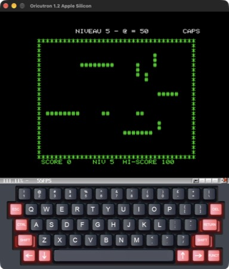
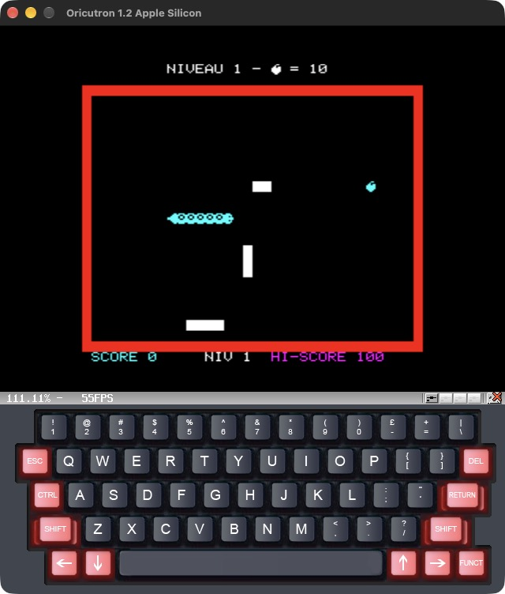
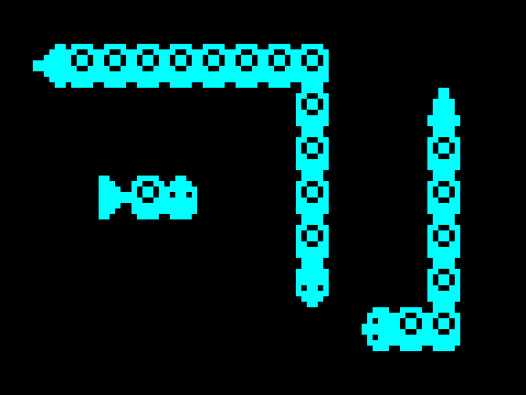
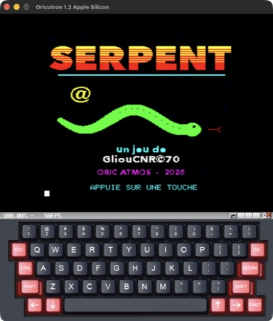

# Programmes Oric (Atmos) testés dans Oricutron

*Créé le 2026-11-21 by GliouCNR©70 — mis à jour le 2026-11-22*

Trois programmes, chacun en source et en cassette `.tap` prête à charger.
Les `.tap` sont aussi copiés dans `~/Library/Application Support/Oricutron/tapes`.

| Programme | Fichiers | Langage | Ce qu'il fait |
|---|---|---|---|
| Démo graphique | `demo-hires.bas` → `demo-hires.tap` | BASIC | Mode HIRES : bandes de couleur, cercles, rayons, texte, son (ZAP, PING). Une touche revient au mode texte. |
| Serpent | `serpent.bas` → `serpent.tap` | BASIC | Petit jeu : flèches pour diriger, mange les `@`, perdu si on touche le bord, un mur ou sa queue. En couleurs : bord rouge plein, serpent cyan, pomme cyan (le `@` redessiné), murs en pavés blancs, SCORE cyan, HI-SCORE magenta. Espace pour jouer. **5 niveaux** (voir plus bas). **Hall of Fame** des 10 meilleurs scores, HI-SCORE affiché pendant la partie. |
| Écran titre | `titre.s` → `titre.tap` | Assembleur 6502 | Titre double hauteur, arc-en-ciel animé, texte défilant. Une touche rend l'écran BASIC d'avant. |

Le serpent existe aussi en **disquette** `serpent.dsk` (lecteur Microdisc), qui
démarre toute seule sur le jeu (copiée aussi dans `~/Library/Application Support/Oricutron/disks`).
Sur la disquette, le Hall of Fame est **sauvegardé** : quand un joueur entre au
classement, son nom et son score sont écrits sur la piste 0, secteur 18, et relus
au démarrage suivant. Oricutron réécrit le fichier `.dsk` tout seul (`diskautosave = yes`).
En cassette, le Hall of Fame marche aussi mais n'est gardé que jusqu'à l'extinction.

**Les 5 niveaux du serpent** (ajoutés le 2026-11-22 by GliouCNR©70) :

- un `@` vaut 10 points au niveau 1, 20 au niveau 2… 50 au niveau 5 ;
- aux niveaux 1 à 4, après 5 `@` mangés, une **porte** de 3 cases s'ouvre dans
  le bord droit, à une hauteur tirée au hasard à chaque niveau (bruit ZAP) ; il
  reste toujours au moins un `*` du bord au-dessus et en dessous. Y entrer fait
  passer au niveau suivant. Le serpent garde
  sa longueur et le score : dans le nouveau tableau, sa tête apparaît à gauche
  et le corps sort du mur derrière elle. Le niveau 5 n'a pas de porte à droite ;
- on peut **revenir** aux tableaux précédents : les niveaux 2 à 5 ont une porte
  à gauche, toujours ouverte, à la même hauteur que la porte de droite du
  tableau d'avant, où le serpent arrive ; elle ramène au tableau d'avant ; le serpent ressort
  par sa porte de droite. Chaque tableau est tiré au hasard la première fois puis
  **mémorisé** (murs, position de la porte, `@` déjà mangés) : on le retrouve à
  l'identique, et une porte ouverte le reste. Tout est retiré au hasard à la
  partie suivante ;
- chaque niveau a des **murs** (pavés blancs) tirés au hasard : 3 au niveau 1, puis 3 de
  plus à chaque niveau (15 au niveau 5), et plus longs (2 à L+3 cases). Ce sont
  des traits droits qui ne touchent ni un autre mur ni le bord, même en
  diagonale : il reste toujours un passage, et la porte est toujours
  accessible (vérifié sur 2 000 tirages simulés). Le départ du serpent et
  le devant de la porte restent libres ;
- la barre de statut (ligne du haut, celle de CAPS) affiche au centre le
  niveau et la valeur d'un `@`, par exemple « NIVEAU 5 - @ = 50 » ;
- le tracé des murs prend quelques secondes au niveau 5 (BASIC).





Les couleurs du terrain n'utilisent **aucune case couleur** (attribut série) :
une telle case s'affiche comme une case vide, et le serpent mourait devant le
bord gauche ou mangeait le `@` sans le toucher (corrigé le 2026-11-22). Le jeu
se sert de la vidéo inverse, qui affiche la couleur complémentaire de l'encre :
encre cyan pour le serpent, bloc plein en inverse = rouge pour le bord, espace
en inverse = blanc pour les murs. La nourriture est le caractère `@` redessiné
en petite pomme, cyan sur noir. Le serpent est dessiné lui aussi (caractères
redéfinis) : des anneaux à écailles, une tête avec deux yeux et un museau,
tournée dans le sens de la marche, et une queue en pointe sur le dernier
anneau.


 Ce qu'on
voit est exactement ce qui touche.

**Écran de présentation** (ajouté le 2026-11-22 by GliouCNR©70) : sur la
disquette, le jeu commence par une image HIRES - SERPENT en dégradé jaune/rouge,
un serpent, un `@`, « un jeu de GliouCNR©70 » - et attend une touche. L'écran
reste noir pendant le chargement (le démarrage efface le message de la ROM),
et ni CAPS ni le curseur ne s'affichent. L'image
est dessinée par `titre_serpent.py` (Python + Pillow, `pip install pillow`) au
format HIRES de l'Oric (`serpent-titre.hir`, 8 000 octets) ; l'aperçu
`captures/serpent-titre.png` est recalculé à partir de ces octets. Une ligne
HIRES n'a qu'une couleur d'encre à la fois : le dessin laisse des cases vides
de 6 pixels où le convertisseur pose les changements de couleur.

```
python3 titre_serpent.py
```



Captures d'écran prises dans Oricutron : dossier `captures/`.

## Lancer un programme

- Glisser le `.tap` sur la fenêtre d'Oricutron (ou Fichier › Insérer une cassette, puis taper `CLOAD""`).
  Les trois programmes démarrent tout seuls après le chargement.
- Depuis le Terminal :
  `/Applications/Oricutron.app/Contents/MacOS/Oricutron "$PWD/serpent.tap"`

## Lancer une disquette

Il faut la ROM `microdis.rom` dans le dossier `roms` d'Oricutron, et choisir le
lecteur Microdisc :
`/Applications/Oricutron.app/Contents/MacOS/Oricutron -k m -d "$PWD/serpent.dsk"`
(ou, dans Oricutron, choisir le lecteur Microdisc puis insérer la disquette, et faire un reset).

## Refaire la disquette

```
python3 oric_dsk.py serpent.bas serpent.dsk serpent-titre.hir   # image facultative
```

Rangement de la disquette (depuis le 2026-11-22) :

| Piste | Secteurs | Contenu |
|---|---|---|
| 0 | 1 | en-tête lu par la ROM du Microdisc |
| 0 | 2 | 1re étape du démarrage, `boot_microdisc.s` |
| 0 | 3 | répertoire (`SYSTEM.DOS`) |
| 0 | 4-5 | 2e étape, `boot_etage2.s` |
| 0 | 18 | données du programme (Hall of Fame) |
| 1, 2… | à partir de 1 | programme BASIC tokenisé et compacté (6 Ko au plus), puis l'image HIRES (32 secteurs) |

Au reset, la ROM du Microdisc lit le secteur 1, puis le répertoire, où elle
trouve `SYSTEM.DOS`, et exécute le code du secteur 2. Cette 1re étape charge la
2e en `$9900` ; la 2e déplace la tête (commande SEEK du contrôleur WD1793),
lit le programme en `$8000` et l'image en `$6000`, ramène la tête sur la
piste 0, démarre le BASIC comme un
vrai reset (sans le test mémoire, qui effacerait tout), puis fait `RUN` dès que
le BASIC affiche `Ready`, en posant 68 (« D ») en `$04FF` pour dire au programme
qu'il a démarré de la disquette. Pas de DOS sur la disquette : `SAVE`/`DIR` n'y
marchent pas. Le serpent lit et écrit son secteur avec une petite routine machine,
`hof_disque.s`, recopiée dans les lignes `DATA` 1000+ de `serpent.bas` et placée
en `$0400` (`CALL #400` lit le secteur dans `$9800`, `CALL #403` l'écrit).

## Refaire les cassettes

```
python3 oric_tap.py basic demo-hires.bas demo-hires.tap DEMO
python3 oric_tap.py basic serpent.bas serpent.tap SERPENT
xa -o titre.bin titre.s && python3 oric_tap.py bin titre.bin titre.tap 0x0800 TITRE
```

`oric_tap.py` transforme un programme BASIC texte en cassette, avec les codes des
mots-clés relus dans la ROM de l'Atmos. Il transforme aussi un binaire 6502 en
cassette qui se lance toute seule. `xa` est l'assembleur 6502 (Homebrew : `brew install xa`).

## Pièges rencontrés (utile pour écrire d'autres programmes)

- **Clavier** : `KEY$` ne voit une touche que si elle est encore enfoncée au moment
  où il est lu. Dans une boucle lente, un appui bref (clavier virtuel, écran tactile)
  passe inaperçu. Lire plutôt la dernière touche mémorisée par la ROM :
  `K=PEEK(735):IF K>127 THEN POKE 735,0:K=K-128` (flèches : 8 gauche, 9 droite,
  10 bas, 11 haut).
- **Noms de variables BASIC** : la ROM reconnaît les mots-clés partout, même au milieu
  d'un nom. Éviter les noms qui contiennent `TO`, `ON`, `OR`, `FN`, `IF`, `PI`, etc.
- **Mode HIRES** : la zone de texte du bas ne fait que 3 lignes ; un `PRINT` de trop
  fait défiler le texte et le fait disparaître.
- **Écran texte en assembleur** : le début de chaque ligne contient des attributs de
  couleur posés par la ROM. Les effacer change les couleurs du BASIC ; il vaut mieux
  sauvegarder l'écran et le remettre en sortant.
- **Disquette Microdisc** : la ROM refuse la disquette (« No operating system on
  disc ») si le secteur 1 de la piste 0 est vide. Il doit contenir en `$12` le
  numéro du secteur du répertoire (3). Le code du secteur 2 doit **finir avant
  l'octet `$F7`** du secteur : la ROM ne charge pas la fin, et un code plus long
  plante au démarrage (écran plein de caractères au hasard). `oric_dsk.py` le
  vérifie. C'est pour cela que le démarrage se fait en deux étapes.
- **HIRES et la mémoire** : la commande `HIRES` déplace le jeu de caractères en
  `$9800-$9FFF` ; tout ce qui est rangé là (2e étape du démarrage, tampon du
  Hall of Fame) est écrasé. L'image est donc copiée par une routine en `$0460`,
  et le Hall of Fame n'est lu qu'après le retour en `TEXT`.
- **Assembleur xa** : un `:` est un séparateur d'instructions, même dans un commentaire,
  et une adresse qui commence par `(` est lue comme un adressage indirect.
