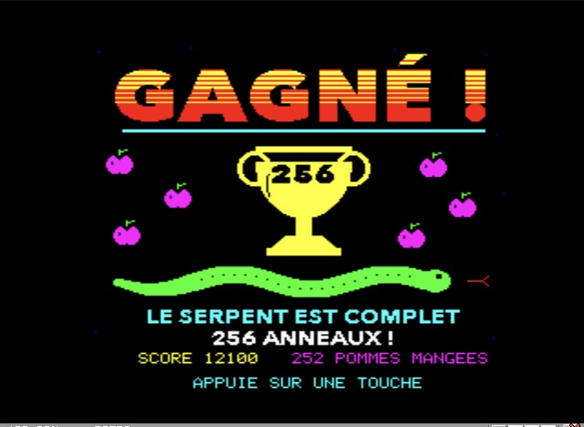

# Programmes Oric (Atmos) testés dans Oricutron

*Créé le 2026-11-21 by GliouCNR©70 — mis à jour le 2026-11-23*

Un dossier par programme (rangement du 2026-11-23 by GliouCNR©70) :

| Dossier | Contenu |
|---|---|
| `demo-hires/` | démo graphique HIRES |
| `serpent/` | jeu du serpent : BASIC, cassette, disquette, image titre, Hall of Fame |
| `titre/` | écran titre en assembleur 6502 |
| `outils/` | outils communs : `oric_tap.py` (cassettes), `oric_dsk.py` (disquettes) et son démarrage Microdisc (`boot_microdisc.s`, `boot_etage2.s`) |

Chaque programme a ses captures d'écran dans son propre dossier `captures/`.

Trois programmes, chacun en source et en cassette `.tap` prête à charger.
Les `.tap` sont aussi copiés dans `~/Library/Application Support/Oricutron/tapes`.

| Programme | Fichiers | Langage | Ce qu'il fait |
|---|---|---|---|
| Démo graphique | `demo-hires/` : `demo-hires.bas` → `demo-hires.tap` | BASIC | Mode HIRES : bandes de couleur, cercles, rayons, texte, son (ZAP, PING). Une touche revient au mode texte. |
| Serpent | `serpent/` : `serpent.bas` → `serpent.tap` | BASIC | Petit jeu : flèches pour diriger, mange les `@`, perdu si on touche le bord, un mur ou sa queue. En couleurs : bord en briques blanches à joints magenta, serpent vert, pomme magenta (le `@` redessiné, en vidéo inverse), murs en pavés blancs, SCORE cyan, HI-SCORE jaune, une ligne vide entre le mur du bas et le score. Espace pour jouer. **5 niveaux** (voir plus bas). **Hall of Fame** des 10 meilleurs scores, avec le nombre de pommes mangées, HI-SCORE affiché pendant la partie. |
| Écran titre | `titre/` : `titre.s` → `titre.tap` | Assembleur 6502 | Titre double hauteur, arc-en-ciel animé, texte défilant. Une touche rend l'écran BASIC d'avant. |

Le serpent existe aussi en **disquette** `serpent/serpent.dsk` (lecteur Microdisc), qui
démarre toute seule sur le jeu (copiée aussi dans `~/Library/Application Support/Oricutron/disks`).
Sur la disquette, le Hall of Fame est **sauvegardé** : quand un joueur entre au
classement, son nom et son score sont écrits sur la piste 0, secteur 18, et relus
au démarrage suivant. Oricutron réécrit le fichier `.dsk` tout seul (`diskautosave = yes`).
En cassette, le Hall of Fame marche aussi mais n'est gardé que jusqu'à l'extinction.

**Les 5 niveaux du serpent** (ajoutés le 2026-11-22 by GliouCNR©70) :

- un `@` vaut 10 points au niveau 1, 20 au niveau 2… 50 au niveau 5 ;
- aux niveaux 1 à 4, après 5 `@` mangés, une **porte** de 3 cases s'ouvre dans
  le bord droit, à une hauteur tirée au hasard à chaque niveau (bruit ZAP) ; il
  reste toujours au moins un `*` du bord au-dessus et en dessous. Y entrer fait
  passer au niveau suivant. Le serpent garde
  sa longueur et le score : dans le nouveau tableau, sa tête apparaît à gauche
  et le corps sort du mur derrière elle. Le niveau 5 n'a pas de porte à droite ;
- on peut **revenir** aux tableaux précédents : les niveaux 2 à 5 ont une porte
  à gauche, toujours ouverte, à la même hauteur que la porte de droite du
  tableau d'avant, où le serpent arrive ; elle ramène au tableau d'avant ; le serpent ressort
  par sa porte de droite. Chaque tableau est tiré au hasard la première fois puis
  **mémorisé** (murs, position de la porte, `@` déjà mangés) : on le retrouve à
  l'identique, et une porte ouverte le reste. Tout est retiré au hasard à la
  partie suivante ;
- chaque niveau a des **murs** (pavés blancs) tirés au hasard : 7 au niveau 1, puis 2 de
  plus à chaque niveau (15 au niveau 5 ; 3, 6, 9, 12 avant le 2026-11-23, jugé trop
  facile au début), et plus longs (2 à L+3 cases). Ce sont
  des traits droits qui ne touchent ni un autre mur ni le bord, même en
  diagonale : il reste toujours un passage, et la porte est toujours
  accessible (vérifié sur 2 000 tirages simulés). Le départ du serpent et
  le devant de la porte restent libres ;
- la barre de statut (ligne du haut, celle de CAPS) affiche au centre le
  niveau, la valeur d'un `@` et le nombre de `@` qu'il **reste** à manger
  (2026-11-23) : avant l'ouverture de la porte aux niveaux 1 à 4, par exemple
  « NIVEAU 2 - @ = 20 - RESTE 3 », puis « PORTE OUVERTE » ; au niveau 5,
  avant que le serpent atteigne 256 anneaux, le plus long que le programme
  peut garder : à 0, la partie est **gagnée** (« GAGNE ! ») ;
- 256 anneaux = **gagné** sur n'importe quel niveau (2026-11-23) : un joueur
  peut redescendre par les portes de gauche aux niveaux 1 à 4 (le serpent
  garde sa longueur, les `@` y valent moins) et y finir la partie ; seul le
  niveau 5 affiche le décompte des anneaux ;
- le tracé des murs prend quelques secondes au niveau 5 (BASIC).

**Robot joueur** (ajouté le 2026-11-23 by GliouCNR©70) : `serpent/bot_serpent.py`
regarde l'Oric en direct, reconnaît chaque case (bord, murs, pomme, tête et sa
direction, corps, queue) et envoie les flèches à Oricutron, sans prendre le
clavier ni la souris. Il vise le **score parfait** : le serpent range ses
positions dans `X(255)`, donc au plus 256 anneaux ; le robot mange juste les 5
`@` qui ouvrent la porte aux niveaux 1 à 4 (500 points, longueur 24), puis 232
`@` à 50 points au niveau 5 : **12 100 points**, et la partie est gagnée.

```
pip install mss numpy pyobjc-framework-Quartz pyobjc-framework-ScreenCaptureKit pyobjc-framework-CoreMedia pyobjc-framework-libdispatch
python3 serpent/bot_serpent.py --fenetre --jouer     # conseillé
python3 serpent/bot_serpent.py --fenetre --jouer --aller-retour 8   # tous les niveaux
python3 serpent/bot_serpent.py                       # montrer la zone avec la souris
```

- `--fenetre` lit la fenêtre d'Oricutron elle-même par ScreenCaptureKit (60
  images par seconde) : on peut la cacher ou changer de bureau pendant la
  partie (mais pas la réduire dans le Dock). L'ancienne capture image par
  image est restée deux fois bloquée 30 s, ce qui tuait le serpent.
- Il faut autoriser le Terminal dans Réglages Système › Confidentialité et
  sécurité › Enregistrement de l'écran.
- Le jeu ne lit qu'une touche par pas : une touche envoyée après avoir vu le
  pas k agit au pas k+2. Le robot décide donc un pas à l'avance et appuie au
  bon moment du pas (après le `WAIT WT` du jeu), soit `WT` + 0,4 pas après
  l'**arrivée** de l'image. 2026-11-23 : le délai partait d'une heure prise
  avant d'attendre l'image (jusqu'à 0,1 s plus tôt) ; la touche tombait
  parfois un pas trop tôt ou trop tard et le serpent mourait au niveau 4 ou
  5. Corrigé, puis vérifié : partie gagnée à 12 100 sans un seul écart de
  direction.
- Un seul robot à la fois : un second lancement s'arrête tout de suite (deux
  robots envoyaient chacun leurs flèches). Après une défaite, le robot ne s'arrête pas :
  il attend la partie suivante (Ctrl-C pour l'arrêter) ; à 256 anneaux il rend la main.
- `BOT_PHOTOS=<dossier>` : le robot photographie l'écran dès que le serpent
  cesse d'avancer (explosion), pour comprendre une défaite.
- `--aller-retour N` (2026-11-23) : au lieu de foncer au niveau 5, le robot
  mange N `@` par visite puis change de tableau - vers la droite jusqu'au
  niveau 5, puis par la porte de gauche jusqu'au niveau 1, et ainsi de suite.
  Au-delà de `--aller-retour-max` anneaux (120) il reste dans le tableau où il
  est et y finit la partie : un serpent très long qui entre dans un tableau
  doit se dérouler depuis la porte, queue bloquée à l'entrée, et s'enfermait
  souvent. `serpent/simu_aller_retour.py` simule des parties complètes :
  30 sur 30 gagnées à 120, 12 sur 20 à 170. En vrai (8 `@` par visite) :
  niveaux 1-2-3-4-5-4-3-2-1-2-3-4-5-4-3, partie **gagnée au niveau 3**
  (7 640 points, 252 pommes), sans un écart de direction.


- Si les images n'arrivent plus, un second fil continue d'envoyer les touches
  et fait avancer le serpent « à l'estime » (tout droit tant que c'est sûr).
- Stratégie : plus court chemin vers la pomme, seulement s'il peut ensuite
  rejoindre sa queue ; sinon suivre sa queue par le plus long détour.
  Vérifié sur un simulateur du niveau 5 : 20 parties sur 20 à 12 100.
- `--test-gel S` fige volontairement la capture 1,5 s toutes les S secondes
  (essai de la marche à l'estime).


Les couleurs du terrain n'utilisent **aucune case couleur** (attribut série) :
une telle case s'affiche comme une case vide, et le serpent mourait devant le
bord gauche ou mangeait le `@` sans le toucher (corrigé le 2026-11-22). Le jeu
se sert de la vidéo inverse, qui affiche la couleur complémentaire de l'encre :
encre verte pour le serpent (comme sur l'image titre, depuis le 2026-11-23),
caractère « briques » en inverse pour le bord : joints magenta (le complément du vert),
briques blanches (2026-11-23 : un bloc magenta plein se confondait avec la pomme), espace
en inverse = blanc pour les murs. La nourriture est le caractère `@` redessiné
en grosse pomme, posée en vidéo inverse : magenta avec un peu de blanc dans
les coins (2026-11-23 : verte, elle se perdait dans un long serpent vert ; une
pomme magenta sur noir est impossible sans case couleur). Le serpent est dessiné lui aussi (caractères
redéfinis) : des anneaux à écailles, une tête avec deux yeux et un museau,
tournée dans le sens de la marche, et une queue en pointe sur le dernier
anneau.


 Ce qu'on
voit est exactement ce qui touche.

**Écran de présentation** (ajouté le 2026-11-22 by GliouCNR©70) : sur la
disquette, le jeu commence par une image HIRES - SERPENT en dégradé jaune/rouge,
un serpent, une pomme magenta comme dans le jeu (un `@` jaune avant le
2026-11-23), « un jeu de GliouCNR©70 » - et attend une touche. L'écran
reste noir pendant le chargement (le démarrage efface le message de la ROM),
et ni CAPS ni le curseur ne s'affichent : le démarrage éteint le curseur et le
verrouillage des majuscules (`$020C`), si bien que la ROM n'a plus jamais de CAPS
à réafficher, même après `TEXT`. Le nom tapé pour le Hall of Fame est remis en
majuscules par le programme. L'image
est dessinée par `serpent/titre_serpent.py` (Python + Pillow, `pip install pillow`) au
format HIRES de l'Oric (`serpent-titre.hir`, 8 000 octets) ; l'aperçu
`serpent/captures/serpent-titre.png` est recalculé à partir de ces octets. Une ligne
HIRES n'a qu'une couleur d'encre à la fois : le dessin laisse des cases vides
de 6 pixels où le convertisseur pose les changements de couleur.

```
python3 serpent/titre_serpent.py
```


**Écran de victoire** (ajouté le 2026-11-23 by GliouCNR©70) : quand le serpent
atteint 256 anneaux, le jeu reste 3 secondes sur le tableau avec « GAGNE ! »,
puis, sur la disquette, affiche une image HIRES - GAGNÉ ! en dégradé, une coupe
« 256 », des pommes, le serpent complet. Dessous, dans les lignes de texte, le
score (jaune) et les pommes mangées (magenta) ; une petite fanfare joue (sol do
mi sol - mi sol), puis une touche mène au Hall of Fame. L'image est chargée au
démarrage avec l'image titre et attend en `$7800-$973F`, au-dessus de HIMEM
(abaissé à `$7800`), que la partie soit gagnée ; la même routine de copie
(`CALL #460`) sert aux deux images. Sur cassette, il n'y a que la pause sur
« GAGNE ! ».

```
python3 serpent/victoire_serpent.py
```



Captures d'écran prises dans Oricutron : dossier `captures/` de chaque programme.

## Lancer un programme

- Glisser le `.tap` sur la fenêtre d'Oricutron (ou Fichier › Insérer une cassette, puis taper `CLOAD""`).
  Les trois programmes démarrent tout seuls après le chargement.
- Depuis le Terminal :
  `/Applications/Oricutron.app/Contents/MacOS/Oricutron "$PWD/serpent/serpent.tap"`

## Lancer une disquette

Il faut la ROM `microdis.rom` dans le dossier `roms` d'Oricutron, et choisir le
lecteur Microdisc :
`/Applications/Oricutron.app/Contents/MacOS/Oricutron -k m -d "$PWD/serpent/serpent.dsk"`
(ou, dans Oricutron, choisir le lecteur Microdisc puis insérer la disquette, et faire un reset).

## Refaire la disquette

```
cd serpent
python3 ../outils/oric_dsk.py serpent.bas serpent.dsk serpent-titre.hir serpent-victoire.hir   # images facultatives
```

Rangement de la disquette (depuis le 2026-11-22) :

| Piste | Secteurs | Contenu |
|---|---|---|
| 0 | 1 | en-tête lu par la ROM du Microdisc |
| 0 | 2 | 1re étape du démarrage, `boot_microdisc.s` |
| 0 | 3 | répertoire (`SYSTEM.DOS`) |
| 0 | 4-5 | 2e étape, `boot_etage2.s` |
| 0 | 18 | données du programme (Hall of Fame) |
| 1, 2… | à partir de 1 | programme BASIC tokenisé et compacté (6 Ko au plus), puis l'image titre et l'image de victoire (32 secteurs chacune) |

Au démarrage, avec deux images (2026-11-23), la 2e étape lit le programme en
`$4000`, l'image titre en `$5800` et l'image de victoire en `$7800`, et fixe
HIMEM à `$7800` ; avec une seule image : programme en `$8000`, image en `$6000`,
HIMEM `$9800` comme avant.

Au reset, la ROM du Microdisc lit le secteur 1, puis le répertoire, où elle
trouve `SYSTEM.DOS`, et exécute le code du secteur 2. Cette 1re étape charge la
2e en `$9900` ; la 2e déplace la tête (commande SEEK du contrôleur WD1793),
lit le programme en `$8000` et l'image en `$6000`, ramène la tête sur la
piste 0, démarre le BASIC comme un
vrai reset (sans le test mémoire, qui effacerait tout), puis fait `RUN` dès que
le BASIC affiche `Ready`, en posant 68 (« D ») en `$04FF` pour dire au programme
qu'il a démarré de la disquette. Pas de DOS sur la disquette : `SAVE`/`DIR` n'y
marchent pas. Le serpent lit et écrit son secteur avec une petite routine machine,
`hof_disque.s`, recopiée dans les lignes `DATA` 1000+ de `serpent.bas` et placée
en `$0400` (`CALL #400` lit le secteur dans `$9800`, `CALL #403` l'écrit).

## Refaire les cassettes

```
python3 outils/oric_tap.py basic demo-hires/demo-hires.bas demo-hires/demo-hires.tap DEMO
python3 outils/oric_tap.py basic serpent/serpent.bas serpent/serpent.tap SERPENT
cd titre && xa -o titre.bin titre.s && python3 ../outils/oric_tap.py bin titre.bin titre.tap 0x0800 TITRE
```

`oric_tap.py` transforme un programme BASIC texte en cassette, avec les codes des
mots-clés relus dans la ROM de l'Atmos. Il transforme aussi un binaire 6502 en
cassette qui se lance toute seule. `xa` est l'assembleur 6502 (Homebrew : `brew install xa`).

## Pièges rencontrés (utile pour écrire d'autres programmes)

- **Clavier** : `KEY$` ne voit une touche que si elle est encore enfoncée au moment
  où il est lu. Dans une boucle lente, un appui bref (clavier virtuel, écran tactile)
  passe inaperçu. Lire plutôt la dernière touche mémorisée par la ROM :
  `K=PEEK(735):IF K>127 THEN POKE 735,0:K=K-128` (flèches : 8 gauche, 9 droite,
  10 bas, 11 haut).
- **Noms de variables BASIC** : la ROM reconnaît les mots-clés partout, même au milieu
  d'un nom. Éviter les noms qui contiennent `TO`, `ON`, `OR`, `FN`, `IF`, `PI`, etc.
- **`WAIT 0`** (2026-11-23 by GliouCNR©70) : ce n'est pas « pas de pause ». Le
  compteur peut repasser de 0 à 65535 et le programme se fige 655 s (près de
  11 minutes). Le serpent se bloquait ainsi au niveau 5 (`WAIT WT` avec WT = 0) ;
  écrire `IF WT THEN WAIT WT`.
- **Mode HIRES** : la zone de texte du bas ne fait que 3 lignes ; un `PRINT` de trop
  fait défiler le texte et le fait disparaître.
- **Écran texte en assembleur** : le début de chaque ligne contient des attributs de
  couleur posés par la ROM. Les effacer change les couleurs du BASIC ; il vaut mieux
  sauvegarder l'écran et le remettre en sortant.
- **Disquette Microdisc** : la ROM refuse la disquette (« No operating system on
  disc ») si le secteur 1 de la piste 0 est vide. Il doit contenir en `$12` le
  numéro du secteur du répertoire (3). Le code du secteur 2 doit **finir avant
  l'octet `$F7`** du secteur : la ROM ne charge pas la fin, et un code plus long
  plante au démarrage (écran plein de caractères au hasard). `oric_dsk.py` le
  vérifie. C'est pour cela que le démarrage se fait en deux étapes.
- **HIRES et la mémoire** : la commande `HIRES` déplace le jeu de caractères en
  `$9800-$9FFF` ; tout ce qui est rangé là (2e étape du démarrage, tampon du
  Hall of Fame) est écrasé. L'image est donc copiée par une routine en `$0460`,
  et le Hall of Fame n'est lu qu'après le retour en `TEXT`.
- **Assembleur xa** : un `:` est un séparateur d'instructions, même dans un commentaire,
  et une adresse qui commence par `(` est lue comme un adressage indirect.
