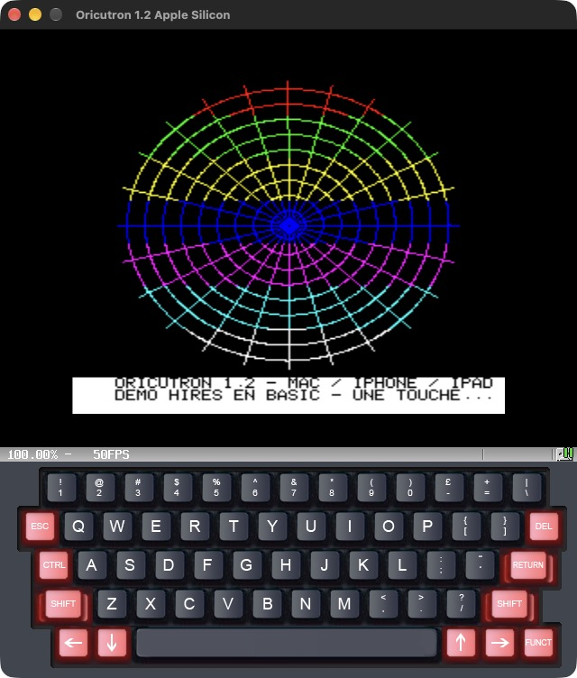

# Démo graphique HIRES — Oric Atmos

*Créé le 2026-11-24 by GliouCNR©70 (repris du LISEZ-MOI commun de `programmes-oric/`)*

Petite démo en BASIC du mode HIRES de l'Atmos (240 x 200 points) : bandes de
couleur, cercles concentriques, étoile de rayons, texte et son (ZAP, PING).
Une touche revient au mode texte.



## Fichiers

| Fichier | Rôle |
|---|---|
| `demo-hires.bas` | le programme BASIC (source) |
| `demo-hires.tap` | la cassette, prête à charger (démarre toute seule) |
| `captures/` | capture d'écran prise dans Oricutron |

## Lancer

Glisser `demo-hires.tap` sur la fenêtre d'Oricutron, ou :

`/Applications/Oricutron.app/Contents/MacOS/Oricutron "$PWD/demo-hires.tap"`

## Refaire la cassette

```
python3 ../outils/oric_tap.py basic demo-hires.bas demo-hires.tap DEMO
```

## Ce que montre le programme

- `HIRES`, `PAPER`, `INK` : passage en haute résolution, fond noir, encre blanche ;
- `CURSET` + `FILL` : bandes de couleur (un attribut de couleur par bande) ;
- `CIRCLE` : cercles concentriques ;
- `DRAW` avec `COS`/`SIN` : étoile de rayons ;
- `ZAP`, `PING` : les sons tout prêts de la ROM ;
- la zone de texte sous l'image ne fait que 3 lignes : un `PRINT` de trop fait
  défiler le texte et le fait disparaître.
