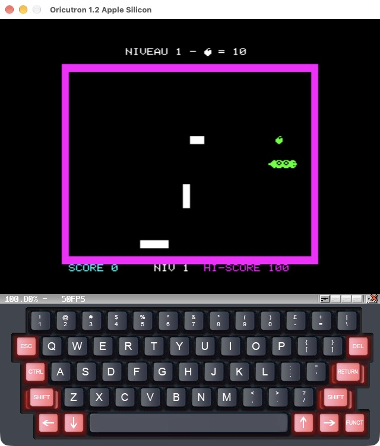
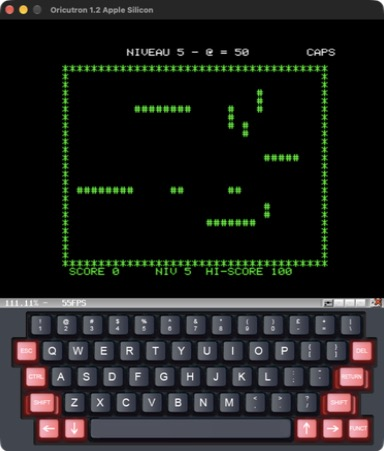
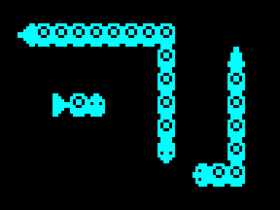
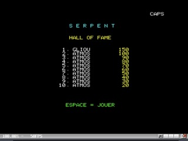
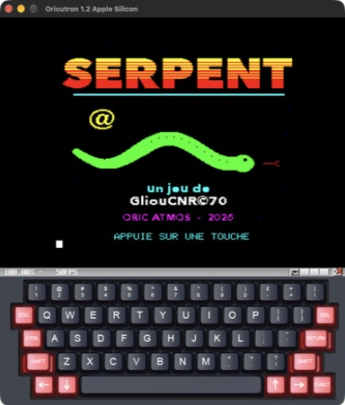
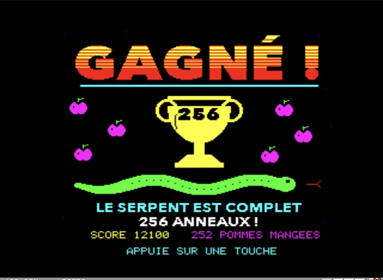
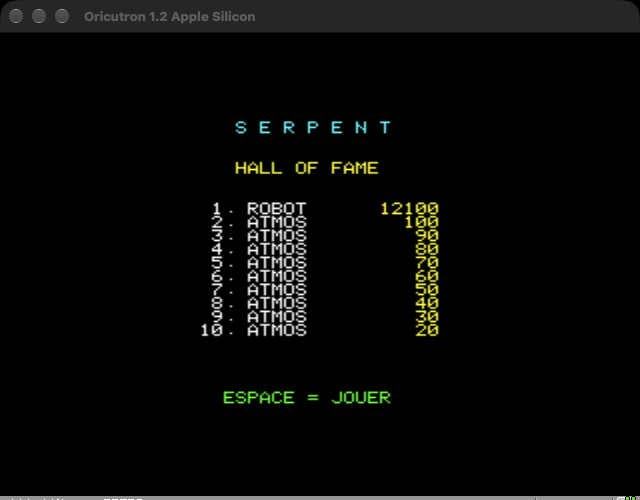
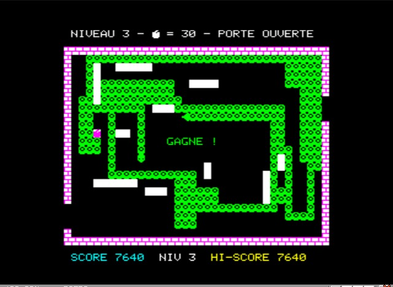

# Serpent — jeu pour Oric Atmos

*Créé le 2026-11-24 by GliouCNR©70 (repris du LISEZ-MOI commun de `programmes-oric/`, où le jeu était décrit depuis le 2026-11-21) — modifié le 2026-11-24 : la pomme dessinée remplace le `@` ; Hall of Fame livré en ORIC ; sons au volume réglable ; barre de statut sans pause, tête et taille du serpent en bas ; longueur au Hall of Fame ; fanfare seulement sur l'image de victoire ; « Version BASIC » sur l'image titre ; la Pastorale de Beethoven dès le chargement (2026-11-26)*

Petit jeu en BASIC : on dirige un serpent avec les flèches, il mange les pommes
et grandit ; perdu s'il touche le bord, un mur ou sa queue. Espace pour jouer.
**5 niveaux** reliés par des portes, **Hall of Fame** des 10 meilleurs scores
(avec la longueur du serpent et le nombre de pommes mangées), écran titre et écran de victoire en HIRES
sur la disquette, et un **robot** qui joue tout seul.



## Fichiers

| Fichier | Rôle |
|---|---|
| `serpent.bas` | le programme BASIC (source) |
| `serpent.tap` | la cassette, prête à charger |
| `serpent.dsk` | la disquette Microdisc, qui démarre toute seule (Hall of Fame sauvegardé) |
| `serpent-commente.txt` | le programme commenté ligne par ligne |
| `titre_serpent.py` → `serpent-titre.hir` | écran titre HIRES (commun avec la version en C) |
| `titre_basic.py` → `serpent-titre-basic.hir` | l'écran titre de la disquette BASIC : le même, avec « Version BASIC » sous la barre cyan |
| `victoire_serpent.py` → `serpent-victoire.hir` | écran de victoire HIRES |
| `titre_copie.s` | routine 6502 qui recopie une image HIRES à l'écran (`CALL #460`) |
| `son.s` → `son.bin` | moteur de son 6502 (en `$5000`) : tic-tac des pas, PING, ZAP, EXPLODE au volume réglé par le joueur, musiques (dont la Pastorale de Beethoven), barre de statut |
| `hof_disque.s`, `HALL-OF-FAME-routine.txt` | lecture/écriture du Hall of Fame sur la disquette, et sa documentation |
| `bot_serpent.py` | le robot joueur |
| `simu_aller_retour.py` | simulateur de parties complètes pour tester le robot |
| `captures/` | captures d'écran prises dans Oricutron |

## Le jeu

En couleurs : bord en briques blanches à joints magenta, serpent vert, pomme
magenta (le `@` redessiné, en vidéo inverse), murs en pavés blancs, SCORE cyan,
HI-SCORE jaune, une ligne vide entre le mur du bas et le score. HI-SCORE est
affiché pendant la partie. Entre SCORE et HI-SCORE (modifié le 2026-11-24 by
GliouCNR©70) : la **tête du serpent** et sa **taille** (256 = gagné), dans les
mêmes couleurs que le décompte de la barre du haut - rouge, puis cyan à partir
de 136, jaune à partir de 196, vert pour les 20 derniers anneaux.

Les nombres de la barre de statut (score, hi-score, taille, décompte du haut)
sont écrits en 6502 par le moteur de son (routine POMME, `CALL #501E`, une
seule instruction BASIC par pomme au lieu de quatre sous-programmes), et le
jeu ne crée plus aucune chaîne pendant la partie : le serpent ne marque plus
de pause quand il mange une pomme (avant : environ 0,3 s).

### Les 5 niveaux (ajoutés le 2026-11-22)

- une  vaut 10 points au niveau 1, 20 au niveau 2… 50 au niveau 5 ;
- aux niveaux 1 à 4, après 5  mangées, une **porte** de 3 cases s'ouvre dans
  le bord droit, à une hauteur tirée au hasard à chaque niveau (bruit ZAP) ; il
  reste toujours au moins une case du bord au-dessus et en dessous. Y entrer
  fait passer au niveau suivant. Le serpent garde sa longueur et le score :
  dans le nouveau tableau, sa tête apparaît à la hauteur exacte où elle a passé
  la porte, et le corps sort du mur derrière elle. Le niveau 5 n'a pas de porte
  à droite ;
- on peut **revenir** aux tableaux précédents : les niveaux 2 à 5 ont une porte
  à gauche, toujours ouverte, à la même hauteur que la porte de droite du
  tableau d'avant ; elle ramène au tableau d'avant, où le serpent ressort par
  la porte de droite. Chaque tableau est tiré au hasard la première fois puis
  **mémorisé** (murs, position de la porte,  déjà mangées) : on le retrouve à
  l'identique, et une porte ouverte le reste. Tout est retiré au hasard à la
  partie suivante ;
- chaque niveau a des **murs** (pavés blancs) tirés au hasard : 7 au niveau 1,
  puis 2 de plus à chaque niveau (15 au niveau 5 ; 3, 6, 9, 12 avant le
  2026-11-23, jugé trop facile au début), et plus longs (2 à L+3 cases). Ce
  sont des traits droits qui ne touchent ni un autre mur ni le bord, même en
  diagonale : il reste toujours un passage, et la porte est toujours accessible
  (vérifié sur 2 000 tirages simulés). Le départ du serpent et le devant de la
  porte restent libres ;
- la barre de statut (ligne du haut, celle de CAPS) affiche au centre le
  niveau, la valeur d'une  et le nombre de  qu'il **reste** à manger
  (2026-11-23) : avant l'ouverture de la porte aux niveaux 1 à 4, par exemple
  « NIVEAU 2 -  = 20 - RESTE 3 », puis « PORTE OUVERTE » ; au niveau 5, les
  anneaux qui manquent pour atteindre 256. Depuis le 2026-11-24, c'est aussi
  ce décompte des anneaux (« RESTE 140 ») qui s'affiche quand on **revient**
  sur un tableau dont la porte est déjà ouverte, et dès la pomme qui suit
  l'ouverture de la porte : « PORTE OUVERTE » ne reste affiché que jusqu'à la
  pomme suivante. En couleurs (2026-11-24) : « PORTE OUVERTE » en **rouge**,
  et le nombre du décompte des anneaux en **rouge** (plus de 120), **cyan**
  (61 à 120), **jaune** (21 à 60), puis **vert** pour les 20 derniers ; la
  pomme de la barre est magenta, comme dans le jeu ;
- **256 anneaux = gagné**, sur n'importe quel niveau (2026-11-23) : c'est le
  plus long que le programme peut garder (positions dans `X(255)`, `Y(255)`).
  Le serpent part de 4 anneaux, la partie parfaite mange donc 252 pommes ;
- le tracé des murs prend quelques secondes au niveau 5 (BASIC).



### Couleurs et dessins

Les couleurs du terrain n'utilisent **aucune case couleur** (attribut série) :
une telle case s'affiche comme une case vide, et le serpent mourait devant le
bord gauche ou mangeait la  sans la toucher (corrigé le 2026-11-22). Le jeu
se sert de la vidéo inverse, qui affiche la couleur complémentaire de l'encre :
encre verte pour le serpent (comme sur l'image titre, depuis le 2026-11-23),
caractère « briques » en inverse pour le bord : joints magenta (le complément
du vert), briques blanches (2026-11-23 : un bloc magenta plein se confondait
avec la pomme), espace en inverse = blanc pour les murs. La nourriture est le
caractère `@` redessiné en grosse pomme, posée en vidéo inverse : magenta avec
un peu de blanc dans les coins (2026-11-23 : verte, elle se perdait dans un
long serpent vert ; une pomme magenta sur noir est impossible sans case
couleur). Le serpent est dessiné lui aussi (caractères redéfinis) : des anneaux
à écailles, une tête avec deux yeux et un museau, tournée dans le sens de la
marche, et une queue en pointe sur le dernier anneau. Ce qu'on voit est
exactement ce qui touche.



**Sons et volume** (ajoutés le 2026-11-24 by GliouCNR©70) : à chaque pas, le
serpent fait « tic, tac », et PING, ZAP et EXPLODE accompagnent les pommes,
les portes et la fin de partie. Ceux de la ROM étaient trop forts et ne se
règlent pas : la ROM met le volume sur l'**enveloppe** de la puce son
(AY-3-8912), qui part toujours de 15, le maximum. Le moteur `son.s` (1 837
octets en `$5000` depuis le 2026-11-26, au-dessus de HIMEM abaissé à `$5000`,
juste sous l'image titre ; il contient aussi l'écriture de la barre de statut
et les musiques) les remplace : il se
branche sur l'interruption de l'horloge de l'Oric (100 fois par seconde) et
fait lui-même baisser le volume, en partant du **volume choisi**. Le jeu ne
l'attend jamais ; le tic-tac coûte moins de 2 % de vitesse.

Sur l'écran du Hall of Fame, une **barre de volume** de 0 à 64 se règle avec
les flèches ← → (par pas de 4 ; 64 = 15, le maximum de la puce). À chaque
réglage, un PING retentit au nouveau volume. Sur la disquette, le volume est
gardé avec le Hall of Fame (octet `$98F0`) et repris au démarrage suivant.

**Musiques** (2026-11-24 by GliouCNR©70) : le moteur `son.s` joue plusieurs
morceaux (choix par `POKE #5013,n` puis `CALL #5010`) : 0 = la **Pastorale**
de Beethoven (depuis le 2026-11-26, voir plus bas), de « CHARGEMENT EN COURS »
jusqu'au début de la partie, et au Hall of Fame après une victoire ; 1 = « perdu »,
un petit air lent et doux en la mineur, sur le Hall of Fame après une
défaite. 2 = la fanfare de victoire (do majeur, appels de trompette jusqu'au
do aigu, basse, ~5,4 s), seulement sur l'image de victoire (modifié le
2026-11-24 by GliouCNR©70 : « GAGNE ! » n'a plus que le ZAP). Chaque musique tourne en boucle jusqu'au début de la partie suivante.
La première musique du titre, en la mineur, et la comptine qui l'a remplacée
du 24 au 26 novembre sont gardées pour d'autres projets dans
[`../musiques/la-mineur-2-voix.s`](../musiques/la-mineur-2-voix.s) et
[`../musiques/comptine-serpent.s`](../musiques/comptine-serpent.s).

**La Pastorale** (2026-11-26 by GliouCNR©70) : Beethoven, Symphonie n° 6 en
fa majeur, op. 68, 1er mouvement (« Éveil d'impressions joyeuses en arrivant à
la campagne »), arrangée pour 2 voix - les premiers violons à la mélodie, les
violoncelles à la basse, ~47 s en boucle : le thème et son point d'orgue, la
phrase des violons, la montée « sol la si♭ si do » répétée, les arpèges sur
le bourdon de fa et le tutti jusqu'à l'accord de fa. Les tables sont faites
dans le projet Musique Oric (branche `Musique-Oric`,
`programmes-oric/musiques/pastorale-beethoven-6.s` et `pastorale_tables.py`)
et recopiées dans `son.s`. Pour qu'elle joue **dès « CHARGEMENT EN COURS »**,
le moteur n'est plus chargé par des lignes DATA sur la disquette : le
démarrage le lit directement en `$5000` (`oric_dsk.py --binaire`), et la ligne
6 du programme le lance avant tout le reste. Les lignes DATA du moteur ne
servent plus qu'à la cassette (elles sont retirées du programme mis sur la
disquette, `--sans-lignes 1070-1999`) : l'écran noir est bien plus court et
l'image titre arrive en une dizaine de secondes. Les tables sont lues avec une
adresse sur 16 bits : un morceau n'est plus limité à 255 octets.

### Hall of Fame

Les 10 meilleurs scores, avec la **longueur** atteinte par le serpent (suivie
de sa tête, ajoutée le 2026-11-24 by GliouCNR©70), puis le nombre de pommes
mangées et la pomme magenta du jeu. La longueur n'est pas rangée sur la
disquette : le serpent part de 4 anneaux et en gagne un par pomme, donc
longueur = pommes + 4 (256 pour une partie gagnée, 252 pommes). Sur la disquette, il est **sauvegardé** : quand un joueur entre au
classement, son nom, son score et ses pommes sont écrits sur la piste 0,
secteur 18, et relus au démarrage suivant. Oricutron réécrit le fichier `.dsk`
tout seul (`diskautosave = yes`). En cassette, le Hall of Fame marche aussi mais
n'est gardé que jusqu'à l'extinction. Détails : `HALL-OF-FAME-routine.txt`.

Le Hall of Fame **livré** (disquette et cassette neuves) ne contient que des
ORIC, avec des scores qui suivent le jeu (modifié le 2026-11-24 by GliouCNR©70) :

| Place | Score | Pommes | Ce que ça représente |
|---|---|---|---|
| 10 | 50 | 5 | porte du niveau 1 ouverte (5 pommes à 10) |
| 9 | 150 | 10 | porte du niveau 2 (+ 5 pommes à 20) |
| 8 | 300 | 15 | porte du niveau 3 (+ 5 pommes à 30) |
| 7 | 500 | 20 | porte du niveau 4 (+ 5 pommes à 40) |
| 6 | 750 | 25 | + 5 pommes au niveau 5 (50 chacune) |
| 5 | 1000 | 30 | + 10 au niveau 5 |
| 4 | 1250 | 35 | + 15 au niveau 5 |
| 3 | 1500 | 40 | + 20 au niveau 5 |
| 2 | 2000 | 50 | + 30 au niveau 5 |
| 1 | 2500 | 60 | + 40 au niveau 5 |

Le nombre de pommes est le **minimum** pour faire ce score : chaque porte
ouverte avec 5 pommes exactement, le reste mangé au niveau 5, où une pomme
rapporte le plus (DATA 1050-1060 de `serpent.bas`).



### Écran de présentation (2026-11-22)

Sur la disquette, le jeu commence par une image HIRES - SERPENT en dégradé
jaune/rouge, un serpent, une pomme magenta comme dans le jeu (un `@` jaune
avant le 2026-11-23), « un jeu de GliouCNR©70 » - et attend une touche. L'écran
reste noir pendant le chargement (le démarrage efface le message de la ROM), et
ni CAPS ni le curseur ne s'affichent : le démarrage éteint le curseur et le
verrouillage des majuscules (`$020C`), si bien que la ROM n'a plus jamais de
CAPS à réafficher, même après `TEXT`. Le nom tapé pour le Hall of Fame est
remis en majuscules par le programme.

L'image affiche « APPUIE SUR ESPACE » (modifié le 2026-11-24 by GliouCNR©70).
La **Pastorale** de Beethoven (modifié le 2026-11-26 by GliouCNR©70 ; c'était
une comptine), mélodie sur le canal A et basse sur le canal C, jouée en boucle
par le moteur de son au volume choisi, démarre dès « CHARGEMENT EN COURS » et
tourne sans s'interrompre sur l'image titre et le Hall of Fame jusqu'au début
de la partie, ce qui aide à régler le volume. À l'appui sur ESPACE, le message s'efface.

Tout est chargé **avant** l'image, pendant que « CHARGEMENT EN COURS » clignote
au milieu de l'écran noir (attribut clignotant de l'Oric, posé par le
démarrage de la disquette puis par le BASIC) : dessins
des caractères (posés en `$B400` : HIRES les range en `$9800` et `TEXT` les
remet), routine disque, Hall of Fame et volume lus sur la disquette, chaînes
du jeu (le moteur de son est déjà en mémoire, lu par le démarrage, et joue). Après l'image, il ne reste qu'à dessiner le Hall of Fame.
HIMEM est à `$5000` (depuis le 2026-11-26), sous l'image titre (`$5800-$773F`) : les noms du Hall of
Fame, lus avant que l'image soit recopiée à l'écran, ne peuvent plus l'abîmer.

L'image est dessinée par `titre_serpent.py` (Python + Pillow,
`pip install pillow`) au format HIRES de l'Oric (`serpent-titre.hir`, 8 000
octets) ; l'aperçu `captures/serpent-titre.png` est recalculé à partir de ces
octets. Une ligne HIRES n'a qu'une couleur d'encre à la fois : le dessin laisse
des cases vides de 6 pixels où le convertisseur pose les changements de couleur.

```
python3 titre_serpent.py
python3 titre_basic.py
```

Sur la disquette BASIC, l'image titre est `serpent-titre-basic.hir` (ajouté le
2026-11-24 by GliouCNR©70) : `titre_basic.py` y écrit « Version BASIC » en
cyan, centré sous la barre cyan, avec les lettres de l'Oric (comme « Version
C » dans la version en C, qui reprend `serpent-titre.hir` tel quel). Le texte
est dans l'image : rien à dessiner pendant que le BASIC tourne.



### Écran de victoire (2026-11-23)

Quand le serpent atteint 256 anneaux, le jeu reste 3 secondes sur le tableau
avec « GAGNE ! », puis, sur la disquette, affiche une image HIRES - GAGNÉ ! en
dégradé, une coupe « 256 », des pommes, le serpent complet. Dessous, dans les
lignes de texte, le score (jaune) et les pommes mangées (magenta) ; une petite
fanfare joue (depuis le 2026-11-24 : vraie fanfare originale à 2 voix,
morceau 2 du moteur de son, en boucle, seulement sur cette image), puis une
touche l'arrête et mène au Hall of Fame, où la Pastorale reprend.
L'image est chargée au démarrage avec l'image titre et attend en
`$7800-$973F`, au-dessus de HIMEM (abaissé à `$7800`), que la partie soit
gagnée ; la même routine de copie (`CALL #460`) sert aux deux images. Sur
cassette, il n'y a que la pause sur « GAGNE ! ».

```
python3 victoire_serpent.py
```



## Lancer le jeu

Cassette :
`/Applications/Oricutron.app/Contents/MacOS/Oricutron "$PWD/serpent.tap"`

Disquette (il faut la ROM `microdis.rom` dans le dossier `roms` d'Oricutron) :
`/Applications/Oricutron.app/Contents/MacOS/Oricutron -k m -d "$PWD/serpent.dsk"`

La cassette et la disquette sont aussi copiées dans
`~/Library/Application Support/Oricutron/tapes` et `.../disks`.

## Refaire la cassette et la disquette

```
xa -o son.bin son.s
python3 ../outils/oric_tap.py basic serpent.bas serpent.tap SERPENT
python3 ../outils/oric_dsk.py serpent.bas serpent.dsk serpent-titre-basic.hir serpent-victoire.hir \
        --binaire son.bin@5000 --sans-lignes 1070-1999
```

Refaire la disquette **efface le Hall of Fame** (secteur 18 vide) : pour garder
celui d'une disquette existante, recopier son secteur 18 dans la nouvelle.
Le rangement de la disquette et le démarrage sont décrits dans
[`../outils/LISEZ-MOI.md`](../outils/LISEZ-MOI.md). Le serpent lit et écrit son
secteur avec une petite routine machine, `hof_disque.s`, recopiée dans les
lignes `DATA` 1000+ de `serpent.bas` et placée en `$0400` (`CALL #400` lit le
secteur dans `$9800`, `CALL #403` l'écrit).

Le programme BASIC est lu directement à sa place en `$0501` : il peut aller
jusqu'à ~21 Ko avec les deux images (il en fait environ 5,9 ; avant le
2026-11-24, la limite était de 6 Ko).

## Le robot joueur (2026-11-23)

`bot_serpent.py` regarde l'Oric en direct, reconnaît chaque case (bord, murs,
pomme, tête et sa direction, corps, queue) et envoie les flèches à Oricutron,
sans prendre le clavier ni la souris. Par défaut, il vise le **score parfait** :
il mange juste les 5  qui ouvrent la porte aux niveaux 1 à 4 (500 points,
longueur 24), puis 232  à 50 points au niveau 5 : **12 100 points**, et la
partie est gagnée.



```
pip install mss numpy pyobjc-framework-Quartz pyobjc-framework-ScreenCaptureKit pyobjc-framework-CoreMedia pyobjc-framework-libdispatch
python3 bot_serpent.py --fenetre --jouer                    # score parfait
python3 bot_serpent.py --fenetre --jouer --aller-retour 8   # tous les niveaux
python3 bot_serpent.py                                      # montrer la zone avec la souris
```

- `--fenetre` lit la fenêtre d'Oricutron elle-même par ScreenCaptureKit (60
  images par seconde) : on peut la cacher ou changer de bureau pendant la
  partie (mais pas la réduire dans le Dock). L'ancienne capture image par
  image est restée deux fois bloquée 30 s, ce qui tuait le serpent.
- Il faut autoriser le Terminal dans Réglages Système › Confidentialité et
  sécurité › Enregistrement de l'écran.
- Stratégie : plus court chemin vers la pomme, seulement s'il peut ensuite
  rejoindre sa queue ; sinon suivre sa queue par le plus long détour.
  Vérifié sur un simulateur du niveau 5 : 20 parties sur 20 à 12 100.
- Le jeu ne lit qu'une touche par pas : une touche envoyée après avoir vu le
  pas k agit au pas k+2. Le robot décide donc un pas à l'avance et appuie au
  bon moment du pas (après le `WAIT WT` du jeu), compté depuis l'**arrivée** de
  l'image (2026-11-23 : il partait d'une heure prise avant d'attendre l'image,
  jusqu'à 0,1 s plus tôt, et la touche tombait parfois un pas trop tôt ou trop
  tard). Depuis le 2026-11-24, ce moment se **règle tout seul** : une touche
  trop tard fait appuyer plus tôt la fois suivante, trop tôt plus tard.
- Si les images n'arrivent plus, un second fil continue d'envoyer les touches
  et fait avancer le serpent « à l'estime » (tout droit tant que c'est sûr).
- Un seul robot à la fois : un second lancement s'arrête tout de suite (deux
  robots envoyaient chacun leurs flèches). Après une défaite, le robot ne
  s'arrête pas : il attend la partie suivante (Ctrl-C pour l'arrêter) ; à 256
  anneaux il rend la main.
- `BOT_PHOTOS=<dossier>` : le robot photographie l'écran dès que le serpent
  cesse d'avancer (explosion), pour comprendre une défaite.
- `--test-gel S` fige volontairement la capture 1,5 s toutes les S secondes
  (essai de la marche à l'estime).

### Aller-retour sur tous les niveaux (2026-11-23)

`--aller-retour N` : au lieu de foncer au niveau 5, le robot mange N  par
visite puis change de tableau - vers la droite jusqu'au niveau 5, puis par la
porte de gauche jusqu'au niveau 1, et ainsi de suite. Au-delà de
`--aller-retour-max` anneaux (120) il reste dans le tableau où il est et y finit
la partie : un serpent très long qui entre dans un tableau doit se dérouler
depuis la porte, queue bloquée à l'entrée, et s'enfermait souvent.
`simu_aller_retour.py` simule des parties complètes :

```
python3 simu_aller_retour.py . 8 0 30 120     # 30 parties sur 30 gagnées
```

(12 sur 20 avec une limite de 170.) En vrai, avec 8  par visite : niveaux
1-2-3-4-5-4-3-2-1-2-3-4-5-4-3, partie **gagnée au niveau 3** (7 640 points, 252
pommes), sans un écart de direction.



### Vitesse d'Oricutron (2026-11-24)

`--mhz N` si Oricutron est accéléré (F1 › Overclock) : les `WAIT` du jeu y
durent N fois moins. Au-delà de 2 MHz, le robot décide deux pas à l'avance au
lieu d'un. Résultats :

| Vitesse | Niveaux 1 à 4 | Niveau 5 |
|---|---|---|
| 1 MHz (vrai Atmos) | oui | oui |
| 2 MHz | oui (pas de 80 à 110 ms) | non (60 ms, plus de pause) |
| 4 MHz | non | non |

Le temps de calcul n'y est pour rien (5 ms) : c'est le flottement de l'image.
Oricutron dessine 50 images/s, l'écran en donne 60 et en saute parfois une, si
bien que l'instant où le jeu relit le clavier, vu depuis l'image, varie de plus
de 40 ms. Sous ~80 ms par pas, aucun réglage ne tient. Au-delà de 8 MHz,
plusieurs pas passent entre deux images d'Oricutron : personne ne pourrait
choisir sa case.

### Compatibilité : Mac, PC et Linux (2026-11-24)

**Le robot ne marche que sur Mac**, avec macOS 12.3 ou plus récent (le
minimum de ScreenCaptureKit). Il a été écrit et testé sur un Mac Apple
Silicon (macOS 27.2, Python 3.14) ; il devrait aussi marcher sur un Mac Intel,
car les bibliothèques utilisées existent pour les deux, mais ce n'est pas
essayé. Le **jeu**, lui, marche partout où tourne Oricutron (Mac, Windows,
Linux) : seul le robot est concerné.

Ce qui le lie au Mac (31 appels dans `bot_serpent.py`) :

| Rôle | Ce que le robot utilise | Équivalent à écrire |
|---|---|---|
| Trouver la fenêtre d'Oricutron | Quartz (`CGWindowListCopyWindowInfo`) | Windows : `FindWindow` / `EnumWindows` ; Linux X11 : `xdotool search` ou Xlib |
| Lire l'écran en continu | ScreenCaptureKit (flux de la fenêtre, même cachée) | `mss` (déjà utilisé par le robot, mais la fenêtre doit rester visible) ; Windows : Windows.Graphics.Capture |
| Envoyer les flèches sans prendre le clavier | Quartz (`CGEventPostToPid`, touches envoyées au seul Oricutron) | Windows : `SendInput` (Oricutron au premier plan) ou `PostMessage` à sa fenêtre ; Linux X11 : XTest ou `xdotool key --window` |
| Un seul robot à la fois | `fcntl` (verrou de fichier) | Linux : identique ; Windows : `msvcrt.locking` |

Limitations à prévoir sur PC et Linux :

- **Windows** : sans équivalent simple de `CGEventPostToPid`, les touches
  partent en général vers la fenêtre au premier plan ; Oricutron devrait donc
  rester devant, et on ne pourrait plus travailler à côté pendant la partie.
  Les codes de touches (flèches, Espace, F1) sont à changer.
- **Linux avec X11** : capture (`mss`) et touches (XTest) sont possibles sans
  droits particuliers ; c'est le portage le plus simple.
- **Linux avec Wayland** (Ubuntu, Fedora récents) : une application n'a pas le
  droit de lire l'écran des autres ni de leur envoyer des touches sans passer
  par les « portails » du bureau, qui demandent une autorisation à chaque fois ;
  le robot n'y marcherait pas tel quel (on peut lancer Oricutron sous XWayland
  ou ouvrir une session X11).
- **Partout** : le robot importe `Quartz` dès le démarrage ; sans lui, il
  s'arrête avant de commencer. Les réglages de temps (appui à 0,4 pas, auto-
  réglé) dépendent de la régularité de l'affichage et seraient à revérifier.

Ce qui marcherait tel quel : la lecture des cases, le cerveau (chemins, sécurité
de la queue, allers-retours), le calage du moment d'appui, et le simulateur
`simu_aller_retour.py` (Python + numpy seulement), qui tourne déjà sur les
trois systèmes. Un portage consisterait à regrouper capture, fenêtre et
clavier dans un petit module par système, autour du même cerveau.
