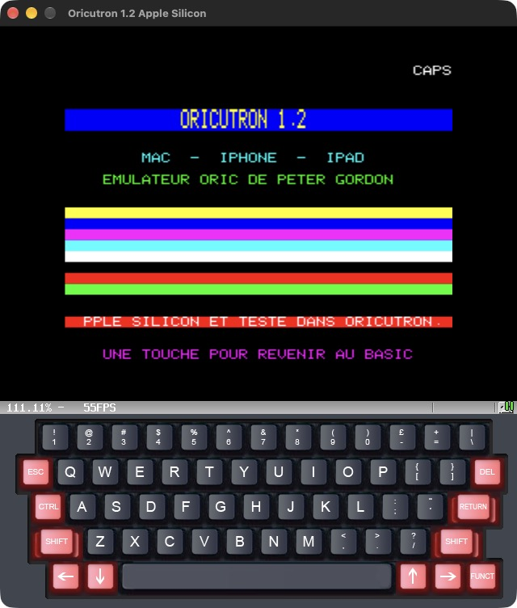

# Écran titre en assembleur — Oric Atmos

*Créé le 2026-11-24 by GliouCNR©70 (repris du LISEZ-MOI commun de `programmes-oric/`)*

Écran titre animé écrit en assembleur 6502 : titre en double hauteur,
arc-en-ciel animé, texte défilant. Une touche rend l'écran BASIC d'avant
(texte et couleurs) et la main au BASIC.



## Fichiers

| Fichier | Rôle |
|---|---|
| `titre.s` | le source 6502 (assembleur `xa`), chargé en `$0800` |
| `titre.tap` | la cassette, prête à charger (démarre toute seule) |
| `captures/` | capture d'écran prise dans Oricutron |

## Lancer

Glisser `titre.tap` sur la fenêtre d'Oricutron, ou :

`/Applications/Oricutron.app/Contents/MacOS/Oricutron "$PWD/titre.tap"`

## Refaire la cassette

```
xa -o titre.bin titre.s
python3 ../outils/oric_tap.py bin titre.bin titre.tap 0x0800 TITRE
```

`xa` est l'assembleur 6502 (Homebrew : `brew install xa`).

## Comment ça marche

Le programme écrit directement dans l'écran texte (`$BB80`, 40 colonnes x 28
lignes). Sur l'Oric, la couleur se règle par des **attributs** placés dans
l'écran, qui occupent chacun une case :

| Valeur | Effet |
|---|---|
| 0-7 | couleur d'encre (0 noir, 1 rouge, 2 vert, 3 jaune, 4 bleu, 5 magenta, 6 cyan, 7 blanc) |
| 16-23 | couleur de fond (papier) |
| 10 | caractères double hauteur (le haut sur une ligne paire, le bas sur la ligne impaire suivante) |

- Le curseur est caché pendant l'animation (bit 0 de `$026A`).
- La dernière touche lue par la ROM est en `$02DF` (bit 7 = nouvelle touche).
- L'écran BASIC est sauvegardé au départ et remis à la sortie : le début de
  chaque ligne contient des attributs posés par la ROM, et les effacer
  changerait les couleurs du BASIC.
- Avec `xa`, un `:` est un séparateur d'instructions, même dans un commentaire.
